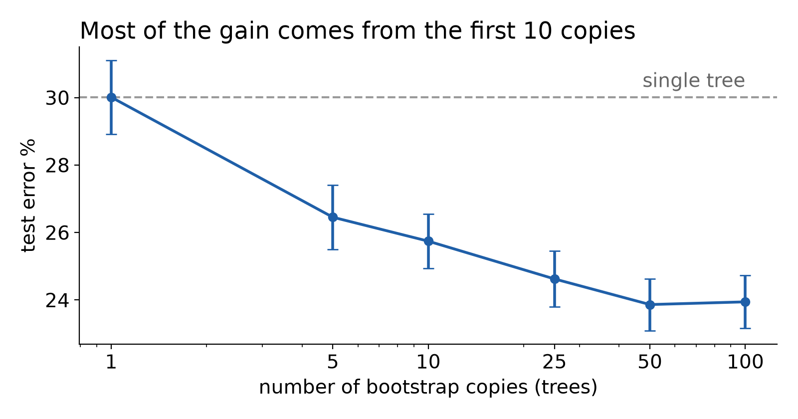
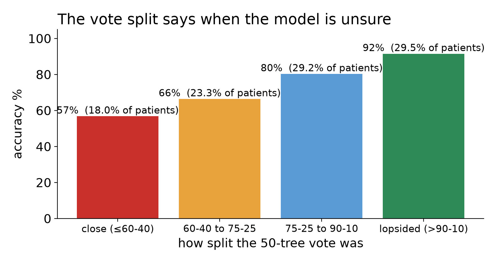

<div class="kicker">DSC 180A · Paper presentation</div>

# Bagging Predictors

### Leo Breiman · *Machine Learning*, 1996

Presented by Sohan Shingade

<br>

<span class="small">bootstrap + aggregating = bagging</span>

---

<div class="kicker">Running example</div>

## Will this patient develop diabetes?

| # | Patient | Glucose | BMI | Age | Diabetic? |
|---|---|---|---|---|---|
| 1 | A | 148 | 33.6 | 50 | yes |
| 2 | B | 85 | 26.6 | 31 | no |
| 3 | C | 183 | 23.3 | 32 | yes |
| 4 | D | 89 | 28.1 | 21 | no |
| 5 | E | 137 | 43.1 | 33 | yes |
| 6 | F | 116 | 25.6 | 30 | no |

A **learner** turns this table into a **model**. Today's learner is a decision tree: a flowchart of yes/no questions picked from the data.

<span class="small">Real rows from the Pima Indians Diabetes dataset (Kaggle / UCI), used again in my experiment.</span>

---

<div class="kicker">The problem</div>

## One tree is unstable

<div class="cols">
<div>

**Tree from patients 1–6**

```
glucose > 127?
├─ yes → diabetic
└─ no  → not diabetic
```

</div>
<div>

**Swap patient F for a new one, retrain**

```
BMI > 30?
├─ yes → age > 40? → ...
└─ no  → not diabetic
```

</div>
</div>

A small change in the learning set gives a completely different model. Breiman calls this **instability**. Trees, neural nets and variable selection are unstable; nearest neighbour is stable.

**Breiman's question:** if one tree is a noisy guess, can we average out the noise?

---

<div class="kicker">The dream</div>

## If only we had many learning sets

With independent learning sets L₁, L₂, … Lₖ we could train a model on each and combine:

| Predicting | Combine by |
|---|---|
| a label (classification) | **majority vote** |
| a number (regression) | **average** |

Breiman writes this as φ_A, the *aggregated* predictor. He shows it is always at least as good as a single φ.

**Problem:** we only ever have **one** learning set L.

---

<div class="kicker">The trick</div>

## Bootstrap: fake the extra learning sets

Draw N patients from L **at random, with replacement**. Some appear twice, some not at all.

| Copy | Patients drawn | Missing |
|---|---|---|
| L⁽¹⁾ | 1, 1, 3, 4, 5, 5 | 2, 6 |
| L⁽²⁾ | 2, 2, 3, 3, 4, 6 | 1, 5 |
| L⁽³⁾ | 1, 2, 4, 5, 6, 6 | 3 |

Each copy holds about **63%** of the distinct patients (1 − 1/e). Different copies, different trees.

<span class="small">Bootstrap: Efron & Tibshirani (1993). Breiman's contribution is using it to grow a committee of models.</span>

---

<div class="kicker">The algorithm</div>

## Bagging = bootstrap aggregating

<div class="cols">
<div>

**Training**
```
for b in 1..B:
    L_b = N draws from L, with replacement
    model_b = learner(L_b)
```

**Prediction**
```
label:  majority vote of model_1..B (x)
number: average of   model_1..B (x)
```

</div>
<div>

**What's new vs. one tree**

Nothing inside the learner changes.

Breiman: all you add is "a loop in front that selects the bootstrap sample and a back end that does the aggregation."

Breiman used **B = 50** for classification, **25** for regression.

</div>
</div>

---

<div class="kicker">Running example</div>

## Three trees vote on a new patient

New patient: glucose 130, BMI 35, age 45.

| Tree | Grown on | Its first question | Says |
|---|---|---|---|
| 1 | L⁽¹⁾ | glucose > 127? | diabetic |
| 2 | L⁽²⁾ | BMI > 30? | diabetic |
| 3 | L⁽³⁾ | age > 48? | not diabetic |

**Vote: 2–1 → diabetic.**

Each tree picked up a different pattern because each saw different patients. The vote cancels out the odd one.

The 2–1 split also tells us something: this prediction is **less sure** than a 3–0 vote. More on that later.

---

<div class="kicker">Why it works · regression</div>

## Averaging never hurts, and helps the unstable

Let e = error of a single model, e_A = error of the aggregated model. Using (E Z)² ≤ E Z²:

<div style="text-align:center; font-size: 34px; margin: 10px 0;">

e_A ≤ e

</div>

How much smaller depends on the gap between [E φ(x, L)]² and E φ²(x, L): the **variance** of the model across learning sets.

| Learner | Model changes with L? | Gain from bagging |
|---|---|---|
| decision tree | a lot | large |
| nearest neighbour | barely | none |

Bootstrap copies are not real new data, so there is a small price. For unstable learners the gain swamps it.

---

<div class="kicker">Why it works · classification</div>

## Voting amplifies whatever the tree does most often

Let Q(j | x) = how often the learner, across learning sets, says class j for input x.

- Single tree: right with probability Q(correct | x), could be 60%.
- Bagged: votes for argmax Q, so if 60% of trees are right, the vote is right **nearly always**.

**The catch:** if the learner is *usually wrong* on x, voting makes it *always* wrong.

> "Bagging unstable classifiers usually improves them. Bagging stable classifiers is not a good idea."

Bagging turns **good** classifiers into **nearly optimal** ones. It does not rescue bad ones.

---

<div class="kicker">In the paper · Table 1 · test error %, lower is better</div>

## Classification trees, 7 datasets, 50 bootstrap copies

| Dataset | Single tree | Bagged | Decrease |
|---|---|---|---|
| waveform | 29.0 | 19.4 | 33% |
| heart (UCSD Medical Center) | 10.0 | 5.3 | **47%** |
| breast cancer | 6.0 | 4.2 | 30% |
| ionosphere | 11.2 | 8.6 | 23% |
| <span class="hl">diabetes (Pima)</span> | <span class="hl">23.4</span> | <span class="hl">18.8</span> | <span class="hl">20%</span> |
| glass | 32.0 | 24.9 | 22% |
| soybean | 14.5 | 10.6 | 27% |

Protocol: random train/test split, one CART tree vs. 50 bagged trees, averaged over **100 splits**. Bagging won on every dataset.

---

<div class="kicker">In the paper · sections 3, 6</div>

## Regression, and how many copies you need

<div class="cols">
<div>

**Regression trees** (Table 3, mean squared error)

| Dataset | Decrease |
|---|---|
| Boston housing | 39% |
| Ozone | 22% |
| Friedman #1 / #2 / #3 | 46% / 30% / 38% |

Average instead of vote. Same story.

</div>
<div>

**How many bootstrap copies?** (waveform)

| Copies | Error % |
|---|---|
| 0 (one tree) | 29.0 |
| 10 | 21.8 |
| 25 | 19.5 |
| 50 | 19.4 |
| 100 | 19.4 |

> "More than 25 bootstrap replicates is love's labor lost."

</div>
</div>

---

<div class="kicker">In the paper · sections 5, 6.3</div>

## When bagging does nothing, or hurts

<div class="cols">
<div>

**Stable learner: nearest neighbour** (Table 5)

| Dataset | Single | Bagged |
|---|---|---|
| waveform | 26.1 | 26.1 |
| heart | 6.3 | 6.3 |
| diabetes | 16.4 | 16.4 |

Identical to the decimal. A test point's nearest neighbour is in ≥ half the copies, so the vote never flips.

</div>
<div>

**Linear regression with variable selection** (Fig. 1)

Pick m of 30 variables. Few variables = unstable, all 30 = stable.

- few variables: bagged **wins**
- many variables: bagged **loses**

The curves cross. And when the single model was already near-optimal, bagging gave nothing.

</div>
</div>

---

<div class="kicker">Summary of the method</div>

## Pros and cons

<div class="cols">
<div>

**Pros**
- Works with any learner, unchanged
- Big accuracy gains on unstable learners (20–47%)
- 10–25 copies capture most of the gain
- Vote split gives a confidence signal
- "Almost a dream procedure for parallel computing": copies never talk to each other

</div>
<div>

**Cons**
- B× the training and prediction cost
- Lose the readable single tree
- Does nothing for stable learners
- Can make a *bad* classifier worse
- Only attacks variance, not bias

</div>
</div>

---

<div class="kicker">My implementation</div>

## The experiment: diabetes from 8 measurements

<div class="cols">
<div>

**768** patients (Kaggle: *Pima Indians Diabetes*)
**8** measurements: glucose, BMI, age, insulin, pregnancies, …
**35%** diabetic (268), the rest not

**Why this dataset**
- It is in Breiman's own Table 1, so I can compare
- Noisy and overlapping classes: trees overfit, which is where bagging should help
- Small, numeric, no missing values

</div>
<div>

**The paper's questions, on new data**
1. Does bagging beat a single tree?
2. How many copies are enough?
3. Does bagging a stable learner (1-NN) move?
4. Does the vote split signal confidence?
5. What does it cost?

**Setup**: sklearn `DecisionTreeClassifier` + `BaggingClassifier`; 80/20 stratified split × **50 random splits**; mean ± 95% CI.

</div>
</div>

---

<div class="kicker">My implementation · 50 random splits · lower is better</div>

## Results: accuracy, confidence, speed

| Method | Test error % (95% CI) | Train (ms) | Predict (µs / patient) |
|---|---|---|---|
| single tree | 30.08 ± 0.98 | 1.1 | 0.2 |
| **bagged trees (50)** | <span class="good">23.86 ± 0.77</span> | 45.3 | 9.6 |
| single 1-NN (stable) | 29.52 ± 0.84 | 0.2 | 2.9 |
| bagged 1-NN (50) | 29.35 ± 0.83 | 17.8 | 106.3 |

- Bagging cut the tree's error by **21%** (Breiman got 20% on this data: 23.4 → 18.8).
- Bagged beats single in **49 of 50 splits** (sign test p < 10⁻¹³).
- 1-NN: 37 of 50 splits identical, as the paper predicts.
- Cost: ~40× training time, ~50× prediction time, still 10 µs per patient.

<span class="small">Breiman's absolute numbers are lower because he duplicated diabetic cases and pruned trees by cross-validation.</span>

---

<div class="kicker">My implementation · question 2</div>

## How many copies? Ten gets most of it



Matches Table 5.1: 30.0 → 25.7 by 10 copies, 23.9 by 50, flat after.

---

<div class="kicker">My implementation · question 4 · confidence</div>

## The vote split knows when the model is unsure



Lopsided votes are right 92% of the time, near-ties are a coin flip. A single tree gives no such signal.

---

## Conclusions

1. **Bagging = bootstrap + vote.** A loop in front, a vote at the back, the learner untouched.
2. **It fixes instability.** Trees: 20–47% less error in the paper, 21% on Pima here. Nearest neighbour: no change, as predicted.
3. **Cheap to get most of the gain.** 10–25 copies.
4. **The vote split is a confidence estimate.** 57% accuracy on close votes, 92% on lopsided ones.
5. **For our project:** each bootstrap copy is an independent job with no communication, so bagging maps directly onto a swarm of learner agents and one coordinator that votes.

<br>

<span class="small">Code and notebook: `slides/bagging_1996/bagging_pima_diabetes.ipynb` in the course repo.</span>
